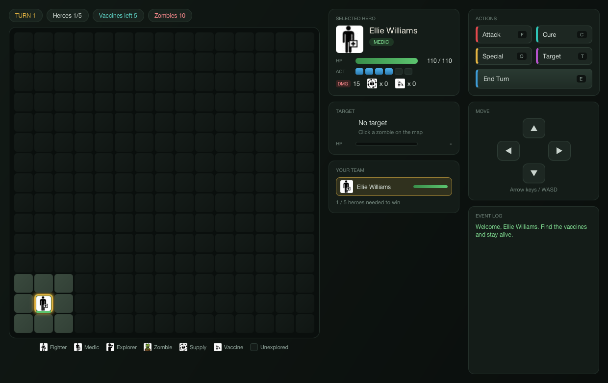

# The Last of Us — Turn-Based Survival Game

A turn-based zombie survival strategy game written in **Java** with a **JavaFX** GUI. It was originally built as a university course project, then revisited with a full visual redesign.

## Gameplay

You start alone on a 15×15 map covered in fog of war, with zombies, supplies, vaccines and hidden traps scattered around.

- **Goal:** collect all 5 vaccines and use them to cure zombies. Each cured zombie becomes a new hero on your team. You **win** when every vaccine has been used and you have **5 heroes**.
- **You lose** if all your heroes die, or if the vaccines run out before your team reaches 5.
- Each hero has a number of **action points** per turn. Moving, attacking and curing each cost 1 action.
- When you **end the turn**, every zombie attacks any hero next to it, a new zombie spawns and your actions refill.
- When you attack a zombie, it hits back for half its damage.
- Traps are invisible. Stepping on one costs HP.

### Hero classes

| Class | Special ability (costs 1 supply) |
|---|---|
| **Fighter** | Attacks cost no actions for the rest of the turn |
| **Medic** | Fully heals an adjacent hero (or themselves) |
| **Explorer** | Reveals the entire map for the current turn |

## Controls

| Action | Mouse | Keyboard |
|---|---|---|
| Move | Arrow pad | Arrow keys / `WASD` |
| Select a hero | Left-click the hero (or their row in the team list) | `Tab` cycles heroes |
| Target a zombie | Left-click it | — |
| Target a hero (for Medic heals) | Right-click it | `T`, then click |
| Attack | Attack button | `F` |
| Cure (uses a vaccine) | Cure button | `C` |
| Special ability | Special button | `Q` |
| End turn | End Turn button | `E` |
| Cancel target mode | — | `Esc` |

Hover over any character to see its full stats.

