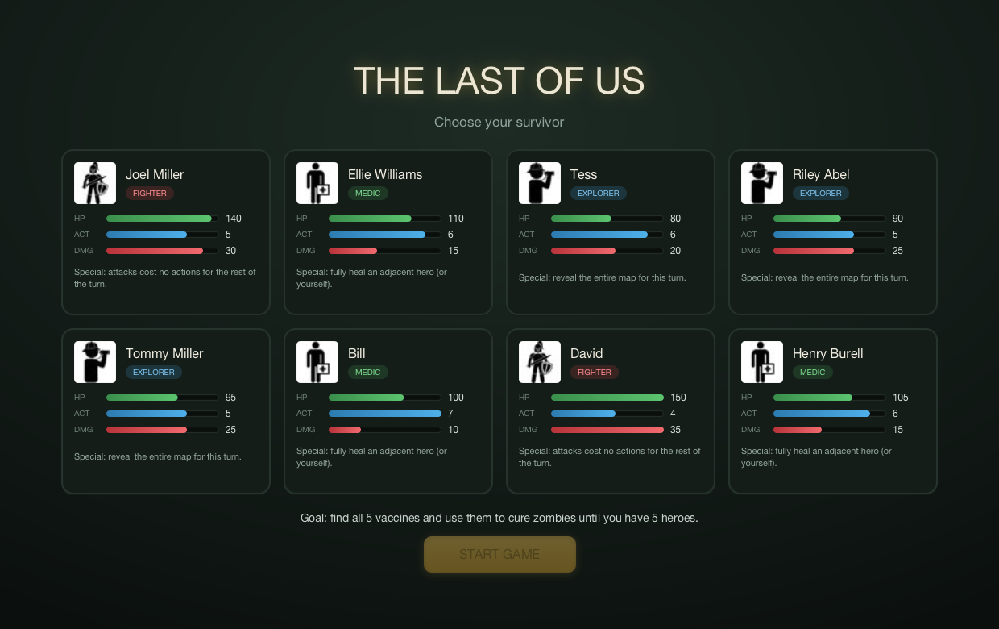
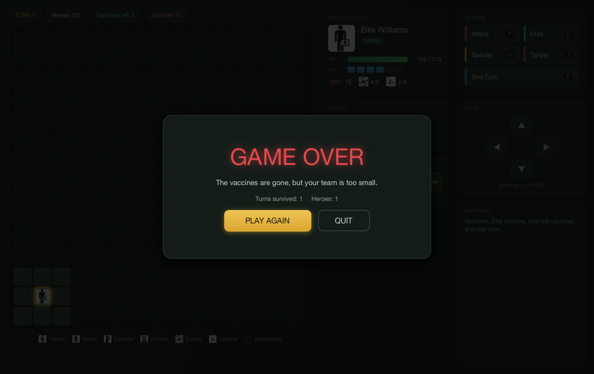

# The Last of Us — Turn-Based Survival Game

A turn-based zombie survival strategy game written in **Java** with a **JavaFX** GUI. It was originally built as a university course project, then revisited with a full visual redesign.



## Gameplay

You start alone on a 15×15 map covered in fog of war, with zombies, supplies, vaccines and hidden traps scattered around.

- **Goal:** collect all 5 vaccines and use them to cure zombies. Each cured zombie becomes a new hero on your team. You **win** when every vaccine has been used and you have **5 heroes**.
- **You lose** if all your heroes die, or if the vaccines run out before your team reaches 5.
- Each hero has a number of **action points** per turn. Moving, attacking and curing each cost 1 action.
- When you **end the turn**, every zombie attacks any hero next to it, a new zombie spawns and your actions refill.
- When you attack a zombie, it hits back for half its damage.
- Traps are invisible. Stepping on one costs HP.

### Hero classes

| Class | Special ability (costs 1 supply) |
|---|---|
| **Fighter** | Attacks cost no actions for the rest of the turn |
| **Medic** | Fully heals an adjacent hero (or themselves) |
| **Explorer** | Reveals the entire map for the current turn |


## Controls

| Action | Mouse | Keyboard |
|---|---|---|
| Move | Arrow pad | Arrow keys / `WASD` |
| Select a hero | Left-click the hero (or their row in the team list) | `Tab` cycles heroes |
| Target a zombie | Left-click it | — |
| Target a hero (for Medic heals) | Right-click it | `T`, then click |
| Attack | Attack button | `F` |
| Cure (uses a vaccine) | Cure button | `C` |
| Special ability | Special button | `Q` |
| End turn | End Turn button | `E` |
| Cancel target mode | — | `Esc` |

Hover over any character to see its full stats.

## Running it

### Requirements

- **JDK 17 or newer** (tested with JDK 21)
- **JavaFX SDK 17+** for your platform, from [gluonhq.com/products/javafx](https://gluonhq.com/products/javafx/). JavaFX is no longer bundled with Java, so you need to download it separately.

### Steps

```bash
git clone https://github.com/youssefmedhatasly/the-last-of-us-game.git
cd the-last-of-us-game

# point the project at your JavaFX SDK (one-time)
ln -s /path/to/javafx-sdk-21 javafx-sdk

./run.sh
```

Alternatively, skip the link and pass the path each time: `FX=/path/to/javafx-sdk-21/lib ./run.sh`.

`run.sh` compiles the sources into `build/`, copies the images and stylesheet, and launches the game. It uses `JAVA_HOME` if set, otherwise JDK 21 on macOS, otherwise the `java` on your `PATH`.

**On Windows:** run the equivalent commands from `run.sh` in Git Bash, or import the project into an IDE (below).

### IDE (Eclipse / VS Code)

The repo includes Eclipse project files (`.project`, `.classpath`), which VS Code's Java extension also reads. With the `javafx-sdk` link in place, JavaFX resolves automatically. Run the main class `views.view` with these VM options:

```
--module-path javafx-sdk/lib --add-modules javafx.controls
```

## Project structure

```
src/
├── engine/       Game.java: game state, map, turns, win/lose checks
├── model/
│   ├── characters/   Character, Hero (Fighter, Medic, Explorer), Zombie
│   ├── collectibles/ Supply, Vaccine
│   └── world/        Cell, CharacterCell, CollectibleCell, TrapCell
├── exceptions/   Game action exceptions (movement, targets, resources)
├── views/        JavaFX UI (view.java), stylesheet, sprites
└── tests/        JUnit 4 public tests from the course
Heroes.csv        Playable heroes: name, class, max HP, actions, damage
```

## Tests

`src/tests/M2PublicTests.java` contains the course's JUnit 4 tests for the game engine. They are not needed to play. To run them, add JUnit 4 to the classpath in your IDE.


